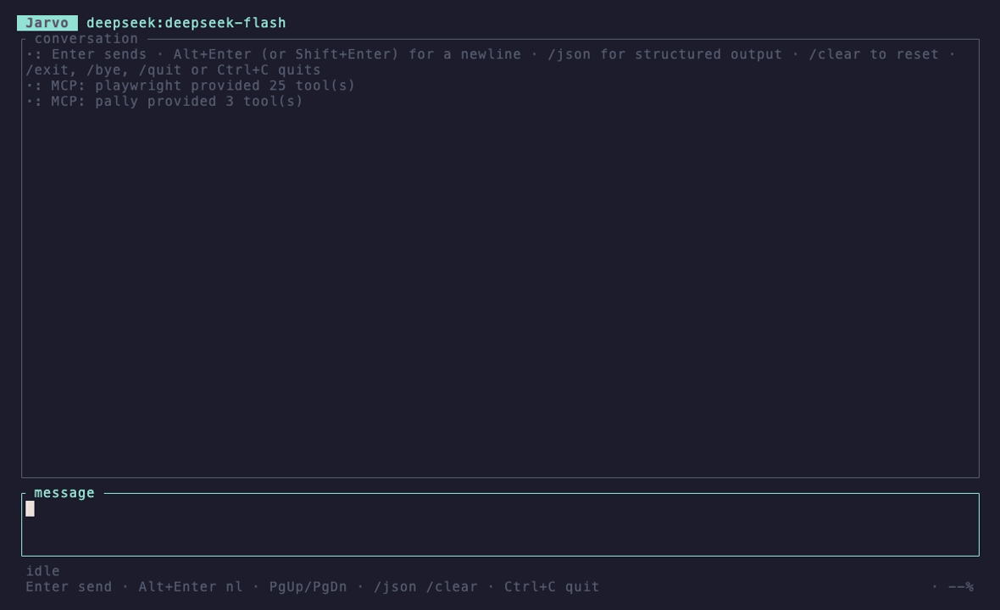

# Jarvo

A lightweight, keyboard-driven AI agent for the terminal, built on
[Rig](https://github.com/0xPlaygrounds/rig) and
[Ratatui](https://ratatui.rs).

- Three providers: **OpenAI**, **DeepSeek**, **Ollama** — selected by CLI flag
  or environment variable, never by editing source.
- Streamed assistant responses rendered into a scrollable chat panel.
- Conversation history kept for the life of the session.
- One native Rust tool (`get_current_time`) plus optional MCP tools.
- Structured JSON output deserialized into a Rust type (`/json`).
- A footer gauge showing how full the context window is.

The crate, the binary and the `RIGAGENT_*` variables keep their original
`rigagent` name; only the interface is branded Jarvo.



A real session: `get_current_time` is called and returned (`→` / `←`), then
`/json` produces an `AnswerCard`. The gauge at the right of the footer tracks
how full the context window is. Regenerate the recording with
`vhs docs/demo.tape` — it drives the real binary and makes real model calls.

## Requirements

- A Rust toolchain supporting edition 2024. No MSRV is declared in
  `Cargo.toml`; this is built and tested on stable 1.99.1 only.
- For `--provider ollama`: a running Ollama daemon with the model pulled.

## Setup

```bash
cp .env.example .env     # then fill in the keys you need
cargo run -- --provider ollama --model llama3.2
```

`.env` is read at startup and is ignored by Git. API keys are never written to
logs or to the interface.

## Running

```bash
cargo run -- --provider openai   --model gpt-4o-mini
cargo run -- --provider deepseek --model deepseek-chat
cargo run -- --provider ollama   --model llama3.2
```

With `RIGAGENT_PROVIDER` and `RIGAGENT_MODEL` set in `.env`, plain
`cargo run` works.

### Options

| Flag | Environment variable | Default | Meaning |
| --- | --- | --- | --- |
| `--provider` | `RIGAGENT_PROVIDER` | `openai` | `openai`, `deepseek` or `ollama` |
| `--model` | `RIGAGENT_MODEL` | per provider | Model name as the provider spells it |
| `--system-prompt` | `RIGAGENT_SYSTEM_PROMPT` | built-in | System prompt for the agent |
| `--max-turns` | `RIGAGENT_MAX_TURNS` | `500` | Model calls plus tool rounds per message |
| `--context-window` | `RIGAGENT_CONTEXT_WINDOW` | per provider | Tokens assumed to fit, for the footer gauge only |
| `--skills-dir` | `RIGAGENT_SKILLS_DIR` | none | Directory of `*/SKILL.md` documents |
| `--shell-dir` | `RIGAGENT_SHELL_DIR` | none | Working directory for `run_shell`; unset disables the tool |
| `--mcp-config` | `RIGAGENT_MCP_CONFIG` | none | Path to an MCP server list |

Default models are `gpt-4o-mini`, `deepseek-chat` and `llama3.2`.

## Environment variables

| Variable | Required for | Purpose |
| --- | --- | --- |
| `OPENAI_API_KEY` | `--provider openai` | OpenAI credential |
| `DEEPSEEK_API_KEY` | `--provider deepseek` | DeepSeek credential |
| `OLLAMA_BASE_URL` | optional | Ollama endpoint, default `http://localhost:11434` |
| `OLLAMA_API_KEY` | optional | Token for an authenticated or hosted daemon |
| `RIGAGENT_LOG_FILE` | optional | File to write logs to; logging is off when unset |
| `RIGAGENT_MAX_TURNS` | optional | Turn cap per message, default `500` |
| `RIGAGENT_CONTEXT_WINDOW` | optional | Assumed context window in tokens, for the footer gauge |
| `RIGAGENT_SKILLS_DIR` | optional | Directory holding the skill library |
| `RIGAGENT_SHELL_DIR` | optional | Working directory for `run_shell`; unset means no shell tool |
| `RUST_LOG` | optional | Log filter, e.g. `rigagent=debug` |

Logging is file-only by design: the TUI owns the terminal, so anything printed
to stdout while it runs would corrupt the display.

## Keyboard

| Key | Action |
| --- | --- |
| `Enter` | Send the message |
| `Alt+Enter` / `Ctrl+J` | Insert a newline |
| `Shift+Enter` | Insert a newline (terminals that support keyboard enhancement) |
| `←` `→` `Home` `End` | Move within the input |
| `Backspace` / `Delete` | Edit the input |
| `PageUp` / `PageDown` | Scroll the conversation |
| `Ctrl+End` | Jump back to the newest output |
| `Ctrl+C` / `Ctrl+D` | Exit |

Scrolling back pauses auto-follow; paging to the bottom (or `Ctrl+End`)
resumes it.

### Slash commands

| Command | Effect |
| --- | --- |
| `/json <prompt>` | Ask for a structured answer, deserialized into `AnswerCard` |
| `/clear` | Forget the conversation |
| `/exit`, `/bye`, `/quit` | Exit, the same as `Ctrl+C` — these work mid-turn too, so a long run never traps you |

## Tools

`get_current_time` is a native Rust tool returning the current UTC instant as
`{ "utc": "...", "unix_seconds": ... }`. A tool-capable model calls it when
asked about the date or time; tool calls and returns appear in the status area
and the transcript (`→ name` / `← name`).

`read_skill` opens a skill body; see [Skills](#skills).

### run_shell

`run_shell` runs a command line through `sh -c` and returns its exit code,
stdout and stderr. It exists because several skills are built on command-line
tools — `cargo test` for test-first work, `git diff` for a review — and a model
that cannot run them can only guess.

It is **off unless `--shell-dir` is set**, and when it is on the conversation
opens with a note saying which directory commands run in. Within those bounds:

- No confirmation. A command runs the moment the model calls it, with this
  process's permissions. The working directory is where commands *start*, not
  a sandbox — a command is free to name an absolute path anywhere, so a shell
  directory is as much access as the account has.
- Every command is logged through `tracing` before it runs. With
  `RIGAGENT_LOG_FILE` set, that log is the record of what was run; without it,
  there is none.
- No stdin. A command that waits for input sees EOF and fails instead of
  hanging the turn.
- Killed after 120 seconds by default, or `timeout_seconds` if the model asks,
  capped at 900.
- Each stream is cut at 24 KB, with `truncated: true` and a byte count, so a
  runaway command cannot flood the context.

Keep it pointed at a directory whose contents are in version control; the git
history is the only undo.

Add a tool by writing a function in `src/tools.rs` and registering it in
`src/agent.rs`:

```rust
#[rig_tool(name = "my_tool", description = "What it does")]
pub fn my_tool(argument: String) -> Result<Output, ToolExecutionError> { ... }
```

## Structured output

`/json <prompt>` asks for an answer shaped like `AnswerCard` (`src/agent.rs`)
and deserializes it with Serde before anything is displayed. If the reply does
not parse, the error is reported — no placeholder is shown.

```rust
pub struct AnswerCard {
    pub title: String,           // a short title
    pub summary: String,         // one or two sentences
    pub key_points: Vec<String>, // most important first
    pub confidence: f32,         // 0.0 to 1.0, self-reported
}
```

Every field is required; a reply missing one fails to parse. `confidence` is
bounded in the generated schema, but a model can still return a value outside
it, so the card is checked after deserializing and an out-of-range value is
flagged in the conversation rather than failing the turn.

Add or rename a field and the schema sent to the model follows automatically —
`schemars` derives it from the struct, so nothing else needs editing.

It goes through Rig's `Extractor`, which offers `AnswerCard`'s JSON schema as a
forced `submit` output tool. That route was chosen over a native
structured-output constraint (`Agent::prompt_typed`) because it works on any
tool-capable model: DeepSeek ignores a native schema and returns prose, which
fails to parse. The cost is that `/json` is one forced turn, so the agent's own
tools are not available inside it.

The structured turn is recorded in the conversation as a plain user/assistant
text pair rather than as the raw `submit` call, so a later message can refer
back to the answer without the chat agent seeing a tool it does not have.

## Skills

A skill is a markdown file with front matter, holding instructions for one
kind of work:

```markdown
---
name: grilling
description: Grill the user relentlessly about a plan. Use when they want to
  stress-test their thinking.
---

The body, in markdown.
```

Point `--skills-dir` at a directory and every `*/SKILL.md` under it is loaded.
Only each skill's **name and description** enter the preamble; bodies are
opened on demand through the `read_skill` tool. A library of thirty skills
therefore costs a few hundred tokens a turn rather than its full weight, and a
skill that names another can have the model open that one too.

Two ways in:

- **The model opens one** when a description matches the work, through
  `read_skill`.
- **You invoke one** as `/name <request>`, for skills meant to be triggered
  deliberately. Front matter's `disable-model-invocation: true` keeps a skill
  out of the model's index while leaving `/name` working, so an interview or a
  handoff never starts by itself.

An unknown `/command` is sent to the model as ordinary text rather than
silently doing nothing.

Bodies are read when asked for, not at startup, so editing a skill takes
effect on the next call instead of the next run.

[mattpocock/skills](https://github.com/mattpocock/skills) works as-is, with
one caveat worth knowing before you point at the whole collection: most of
those skills are written for an agent that can read and write files and run
tests. This application has a browser and a skill library and no filesystem
tools, so a skill like `tdd` or `implement` will tell the model to do things
it has no way to do. It reports that rather than pretending, but the skill is
still useless. The conversational ones (`grilling`, `grill-me`, `teach`,
`wait-what`, `to-questionnaire`, `writing-for-agents`, `codebase-design`,
`handoff`) work today; the rest want the filesystem MCP server below.

## MCP (optional)

MCP is off unless `--mcp-config` / `RIGAGENT_MCP_CONFIG` names a file. Copy
`mcp.example.json` and list the stdio servers to launch:

```json
{
  "servers": [
    {
      "name": "filesystem",
      "command": "npx",
      "args": ["-y", "@modelcontextprotocol/server-filesystem", "/tmp"],
      "env": {},
      "enabled": true
    }
  ]
}
```

Their tools join the native ones. **No MCP server is needed to run the
application**: a missing config, an unparseable config, or a server that fails
to start is reported as a line in the conversation and startup continues.

### Playwright (configured)

`mcp.json` in this repo starts [Playwright MCP](https://github.com/microsoft/playwright-mcp),
which gives the agent 25 browser tools (`browser_navigate`, `browser_snapshot`,
`browser_click`, `browser_evaluate`, `browser_take_screenshot`, …):

```bash
cargo run -- --mcp-config mcp.json
```

`RIGAGENT_MCP_CONFIG=mcp.json` is set in `.env`, so plain `cargo run` already
loads it; delete that line to go back to native tools only.

The flags in `mcp.json` are deliberate:

| Flag | Why |
| --- | --- |
| `--isolated` | Browser profile stays in memory, never written to disk and never your real Chrome profile |
| `--output-dir .playwright-output` | Screenshots land in one gitignored place instead of the repo root |

The browser runs **headed**: a real window opens when the agent navigates.
That is deliberate — watching the page is how you tell a stuck run from a slow
one, and a browsing agent is worth watching. Add `--headless` to `mcp.json` if
you would rather it stayed out of sight.

The version is pinned (`@playwright/mcp@0.0.83`) so a new release cannot change
the tool surface under you. Playwright MCP also restricts filesystem access to
the working directory by default; `mcp.json` does not pass
`--allow-unrestricted-file-access`.

Two costs worth knowing: 25 extra tool definitions go to the model on every
turn, which is not free in tokens, and the first launch after an `npx` cache
miss adds a few seconds to startup because `load` is awaited before the TUI
opens.

Browsing takes many rounds — navigate, snapshot, click, snapshot again — so the
turn cap is 500 by default rather than something tight. That is a stop against
a model looping forever, not a spending limit: 500 turns is 500 billed model
calls if a run really goes that far. Lower it with `--max-turns` for a session
where that matters, and remember `Ctrl+C` exits cleanly mid-turn if a run gets
away from you, and `/exit` and `/bye` do the same from the input line.

### Remote servers over a bridge (Pally)

`mcp.json` also starts Pally through
[`mcp-remote`](https://www.npmjs.com/package/mcp-remote):

```json
{ "name": "pally", "command": "npx", "args": ["-y", "mcp-remote", "https://agent.pally.com/mcp"] }
```

Pally is not a stdio server — it is Streamable HTTP with OAuth 2.1 (dynamic
client registration plus PKCE). `mcp-remote` bridges the two: it speaks stdio
to us and HTTP to Pally, and it owns the OAuth flow. Authorize once, in a
browser, before the first run:

```bash
npx -y mcp-remote https://agent.pally.com/mcp
```

Tokens are cached in `~/.mcp-auth`, outside this repository, so no credential
is written to `mcp.json`. The same bridge reaches any remote MCP server, which
is how to use one without HTTP support in `src/mcp.rs`.

**Pally acts on real accounts** — mail, calendar, messages, purchases — and
this application has no approval step: when the model decides to call a tool,
the tool runs. Against a 500-turn cap that is worth thinking about. Use a low
`--max-turns` while finding your feet, and set `"enabled": false` when you are
not using the server.

## Voice input

No code here handles audio. Dictation works because the operating system types
into the terminal like a keyboard: macOS dictation (Fn Fn), or a local
push-to-talk transcriber such as [Handy](https://handy.computer).

Two settings matter for a TUI. Keep auto-submit **off**, so a mis-heard
sentence is yours to correct before `Enter` sends it — with MCP tools
attached, a wrong transcript can become a real action. And if nothing appears
when you dictate, switch the tool's paste method from `ctrl_v` to direct
typing: `Ctrl+V` is not paste in a terminal, and the input handler ignores
control-modified characters.

## The context gauge

The right-hand end of the footer shows how full the context window is: the
tokens in use against the window they are measured in (`5k/1M`), and one of
five weather glyphs covering an equal fifth each:

| Glyph | Fill | Reading |
| --- | --- | --- |
| ☀ | 0–19% | Sunny — room to spare |
| ⛅ | 20–39% | Partly cloudy |
| ☁ | 40–59% | Overcast |
| 🌧 | 60–79% | Rain — consider `/clear` |
| ⛈ | 80–100% | Storm — the next turn may not fit |

The numerator is real: Rig reports each completion call's token usage, and the
gauge takes the last call of a turn, prompt plus reply, which is what the next
turn starts from. Tool definitions count toward it, so a session with MCP
servers attached starts well above zero before you type anything.

The denominator is an assumption. No provider reports its own context window,
so `src/config.rs` keeps a small table of models it has been run against
(`deepseek-flash` 1M, `deepseek-chat` 64k, `gpt-4o`/`gpt-4o-mini` 128k),
matched as a prefix so dated variants resolve to their base model. A model
outside the table falls back to a conservative per-provider floor (`openai`
128k, `deepseek` 64k, `ollama` 8k), which understates a large window rather
than inventing room that is not there.

Windows belong to models, not providers, and the table is maintained by hand,
so it will fall behind. `--context-window` overrides it.

`/json` does not move the gauge. The extractor is a separate run carrying
only the `submit` tool, so its request is much smaller than the chat agent's;
reporting it would make the context look as though it had shrunk. The figure
from the last ordinary turn stands until the next one.

Tokens rather than a percentage, because the windows models now ship with
make a percentage useless. 5,000 tokens of a million is 0%, and stays 0%
through a long conversation. The glyph carries the proportion; the numbers
carry the scale. Counts are rounded down to four characters at most, so the
gauge never claims more room is used than is.

Two cases show `· --/<window>` instead of a count: before the first reply, and
whenever the provider reports no usage at all. Ollama commonly reports none.
An unknown figure is never drawn as `0%`, because an unknown context and an
empty one are not the same thing.

## Project layout

```text
src/
├── main.rs        entry point, logging
├── config.rs      CLI arguments and environment
├── providers.rs   provider and model initialization
├── agent.rs       conversation, streaming, tools, structured output
├── tools.rs       native tool implementations
├── mcp.rs         optional MCP client setup
└── tui/
    ├── mod.rs     terminal lifecycle, input events, main loop
    ├── app.rs     application state
    └── ui.rs      rendering
```

The agent runs in its own Tokio task and communicates with the interface over
two `tokio::sync::mpsc` channels (commands out, events in), so rendering and
key handling never block on the model.

## Development

```bash
cargo fmt
cargo check
cargo clippy --all-targets -- -D warnings
cargo test
```

## Limitations

These are the honest edges of this implementation, not stubs:

- **Shift+Enter** needs a terminal that supports keyboard enhancement (Kitty,
  WezTerm, Ghostty, recent Alacritty). Elsewhere it is indistinguishable from
  `Enter`; use `Alt+Enter` or `Ctrl+J`.
- **Streaming and tool calling depend on the model**, not just the provider. An
  Ollama model without tool support will not call `get_current_time`, and the
  agent reports that rather than simulating a call.
- **Structured output needs a tool-capable model.** `/json` forces a `submit`
  output tool; a model that cannot call tools cannot answer it, and the failure
  is reported. It is also a single turn, so `get_current_time` and MCP tools
  are not reachable from `/json`.
- **MCP transport is stdio only.** `src/mcp.rs` launches child processes;
  Streamable HTTP and SSE are not implemented. Remote servers are reachable
  through an `mcp-remote` bridge, as the Pally entry in `mcp.json` shows, which
  also keeps OAuth out of this codebase.
- **No tool run is confirmed.** Every tool the model calls, native or MCP,
  executes immediately. There is no allow-list and no prompt. `Ctrl+C` or
  `/exit` is the only interruption, and it ends the session. This matters most
  for `run_shell`, which is why it stays off until `--shell-dir` is given.
- **`run_shell` is not sandboxed.** `--shell-dir` sets where commands start,
  nothing more. A command can read or write anything the account can, `.env`
  included, and the timeout and output caps bound the damage of a runaway
  command, not of a deliberate one.
- **History is per-session.** Nothing is persisted; there is no vector store,
  retrieval or long-term memory.
- `Paragraph::line_count`, used to measure the wrapped transcript for
  scrolling, is behind Ratatui's `unstable-rendered-line-info` feature. The
  version is pinned in `Cargo.lock`.
